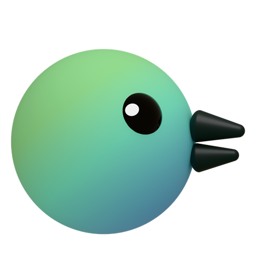
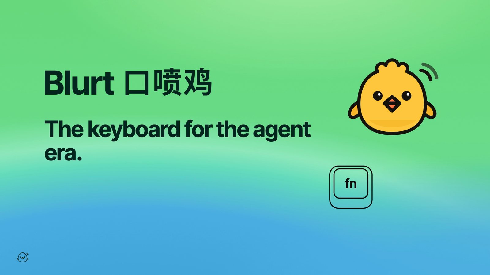

<p align="center"><picture><source media="(prefers-color-scheme: dark)" srcset="assets/peep-readme-dark.png"></picture></p>
<h1 align="center">Blurt</h1>
<p align="center"><b>The keyboard for the agent era.</b><br>
The fastest way to work with your agents, by text, voice, screenshot or screen recording. Runs locally. Free and open source.<br>
<a href="https://blurt.work/en/">Website</a> · <a href="README.zh-CN.md">中文</a> · <a href="docs/guide.md">User guide</a></p>

<p align="center"><a href="https://blurt.work/en/#film"></a></p>
<p align="center"><sub>Watch the 2-minute film, sound on · <a href="https://github.com/AGIHunt/blurt/releases/latest/download/Blurt.dmg">Download for Mac</a></sub></p>

---

Blurt is a menu-bar app for the Mac; Windows and Linux are coming soon. It works next to the agents you already use, such as Claude Code, Codex, Cursor,
Claude and ChatGPT, and handles the part before they start: getting what you mean into the agent's input box. It has
no agent of its own and doesn't replace yours.

## What it does

**Dictation (`Fn`).** Tap `Fn` in any app, talk, and tap it again. The words are typed where your cursor is. Finish
with a double tap instead and it's sent too (Return). It works the moment Blurt is installed, with macOS's own speech
recognition (macOS 26) and nothing to download. Open-source local models are an optional upgrade: more accurate, they
learn your words and need no internet; after a minute of talking the text is in about 0.4 s. A local model removes
fillers and stutters and adds punctuation; it doesn't rewrite or summarize. The words show under the notch as you
talk. Tap `⇧` while talking to switch to Structured (a list, when you listed things) and again to switch back; tap `⌘`
to translate (speak Chinese, type English, or the other way round); `⌥L` reformats the last dictation. Holding `Fn`
while you talk works too.

**Snap (`⌥A`) and Voice Note (`⌥V`).** Drag over part of the screen and say what's wrong; the note opens right
beside the selection. Draw on it as you talk: drag for a freehand line, `⇧` for a box, `⌥` for an ellipse, `⌘Z` to
undo. The snap becomes a card under the notch. Drag the card into Claude, ChatGPT, Slack or a terminal running Claude Code or Codex: the picture and
your note go in together. Or click it to copy, then `⌘V`. A voice note is the same, with your words and no picture.

**Copy text from screen (`⌥C`).** Drag over any text you can't select: a screenshot, a video, a locked page, a
terminal. Let go and it's on the clipboard in about 0.2 s, laid out as if you had copied it: the half line the edge
cut is left out, wrapped list items are one line again, tables keep their tabs and code its indentation. It reads with
macOS's own recognizer, so there's nothing to download. Optionally a second reading by a small local OCR model
(720 MB) or your own cloud model fixes misread symbols in code and paths.

**Record (`⌥R`).** Record your screen while you talk through a product, a page or an idea. Your coding agent turns
the recording into items (issues, ideas, notes, tasks), each with a screenshot, the spot marked, steps and the code
that is probably involved. It's transcribed while you record, so it's done about a minute after you stop; one
5-minute walkthrough became 52 items, each with what was said and when. You go through them with the keyboard, then
hand them to an agent, or pack them into one `.zip` for a teammate.

Snaps, voice notes and recordings go into the current project (a folder you open in Blurt). Without one, recordings
go to Unassigned and snaps stay as cards until you pick a project. Every shortcut can be changed in Settings.

## Install

You need macOS 13 or later. Dictation and the recommended speech models need Apple silicon.

**[Download Blurt for Mac](https://github.com/AGIHunt/blurt/releases/latest/download/Blurt.dmg)** (signed and
notarized), open the disk image and drag Blurt into Applications. Updates arrive inside the app. The app brings
everything it runs, so there is nothing else to install.

Or give this to your agent (Claude Code, Codex…), or paste it into a terminal:

```bash
curl -fsSL https://blurt.work/install.sh | sh
```

It downloads the latest release, checks that it is signed and notarized, puts Blurt in Applications and opens it.

**Use it from your agent.** In Blurt, *Settings → Agents → Connect…* adds the Blurt skill and MCP server to Claude
Code, Codex and the other agents it finds (Gemini CLI, Kimi Code, OpenCode, Grok, CodeBuddy Code, WorkBuddy,
Cursor). Start a new session of the agent, then tell it **"start blurt"** (`/blurt` in Claude Code, `$blurt` in
Codex), or ask it about your items. Your agent can also do the connecting: [llms.txt](https://blurt.work/llms.txt) has
the steps.

<sub>Without the app, from source: <code>npx skills add AGIHunt/blurt -g</code>, or in Claude Code <code>/plugin
marketplace add AGIHunt/blurt</code> and then <code>/plugin install blurt@blurt</code>. Then "start blurt". The first run
builds Blurt into <code>~/Applications</code>; it needs the Xcode Command Line Tools and
<a href="https://docs.astral.sh/uv/">uv</a>, and the agent offers to install what's missing.</sub>

**First minute.** The setup assistant asks for Microphone and Accessibility (and Input Monitoring if you use another
key than `Fn`). Then press `Fn` in any text field: dictation already works with macOS's own recognizer. Two optional
upgrades: one AI-service key (fixes misheard names and punctuation, and powers translation and the cloud second
reading of copied text), and the local models (1–6 GB depending on your Mac's memory, downloaded only when you click
Download). Screen Recording is asked for the
first time you snap or record.

## How it works with your agents

Blurt gets your words, pictures and recordings into an agent. The agent does the work.

| | What it does |
|---|---|
| **Dictation and cards** | Text and pictures go into any chat box or terminal, so they work with every agent. |
| **Skill** | The `blurt` skill lets your agent record, transcribe, write items, open the review page and export. |
| **MCP server** | `blurt` gives agents `search_items`, `get_item` (with screenshots), `get_transcript`, `update_item`, `mark_fixed` and `bundle_items`. *Settings → Agents → Connect…* installs the skill and the MCP server into an agent, after showing what it changes. |
| **Hand off to agent** (`⌘↩`) | Runs Claude Code or Codex in Blurt's terminal, in the project folder, optionally with one git worktree per item. Claude Code can also run in the Claude desktop app. |
| **Copy instruction** | One line for any other agent, pointing to a hand-off note with every detail and screenshot. |
| **Hand-off bundle** | One `.zip` with a summary, every item and its screenshots, for a person rather than an agent. |

Agents report back through the MCP server: an item moves to *In progress*, then *To verify*. "Fixed" from an agent
always means *to verify* until you mark it done.

Recordings are organized by the first agent that is installed and signed in: Claude Code, then Codex, Kimi Code,
OpenCode, Gemini CLI and Grok. You can change the order in *Settings → Agents*.

**No connectors, by design.** Your agent already has tools for Slack, Linear, GitHub, Notion, Jira and Feishu/Lark.
Blurt writes files (Markdown, CSV and the hand-off bundle) and leaves delivery to the agent. To send items somewhere,
ask it, for example: "Bundle the checkout issues and post them to #web in Slack."

## How Blurt compares

Checked on **2026-10-25**. Prices and policies change.

Blurt's numbers come from its own tests on one machine, an Apple M5 Max with 128 GB, with speech generated by macOS
`say`. Synthetic speech is cleaner than a real microphone, so error rates are optimistic; smaller Macs, real
microphones and accents were not measured. Competitor numbers come from other people and methods, some from a
competing vendor, and are not directly comparable.

| | **Blurt** | Typeless | Wispr Flow | Superwhisper | Aqua Voice |
|---|---|---|---|---|---|
| Price | Free, MIT licence, no word limit | Free with a weekly limit; Pro $12/month yearly, $30 monthly [1] | Free 2,000 words/week on desktop; Pro $15/month, $12/month yearly [2] | Free with local models; Pro $8.49/month [3] | Free 1,000 words; Pro $12/month, $10/month yearly [4] |
| Where speech is processed | On your Mac | Cloud [5] | Cloud [6] | Local or cloud, your choice [7] | Cloud [8] |
| End of speech → text | 0.29–0.54 s after 3–60 s of speech | about 3.0 s [9] | about 1.5 s [9] | not published | "about 450ms" (vendor) [8] |
| English accuracy | WER 1.9 % (speech model alone) | WER about 7.9 % [9] | WER about 3.9 % [9] | depends on the model; not published | OpenASR average WER 6.24 (vendor) [10] |
| Chinese accuracy | CER 1.3 % (speech model alone) | not published | not published | not published | not published |
| Platforms | macOS; Windows and Linux coming soon | macOS, Windows, Linux, iOS, Android | Mac, Windows, iOS, Android | Mac, Windows, iOS, Android | Mac, Windows, iOS, Android |
| Offline | Dictation needs no network once the models are downloaded (not yet tested with the network off) | No | No | Yes, with local models | No |
| Snap and voice-note cards for agents | Yes | No | No | No | No |
| Screen recording → items with screenshots and code pointers | Yes | No | No | No | No |
| Hand-off to coding agents, status back through MCP | Yes | No | No | No | Lists "MCP/CLI" on its free plan; not examined |

<sub>Blurt sources: latency `docs/design/dictation.md` (median of 3 takes, warm models); accuracy
`docs/design/asr-benchmark.md` (Qwen3-ASR 1.7B, 7 sentences × 2 voices per language). Full detail and the numbers we
could not verify: [docs/positioning/facts.md](docs/positioning/facts.md).
[1] [typeless.com/pricing](https://www.typeless.com/pricing) ·
[2] [wisprflow.ai/pricing](https://wisprflow.ai/pricing) ·
[3] [superwhisper.com](https://superwhisper.com/) ·
[4] [aquavoice.com/pricing](https://aquavoice.com/pricing) ·
[5] [Typeless data controls](https://typeless.com/data-controls), updated 2026-10-13 ·
[6] [Wispr Flow data controls](https://wisprflow.ai/data-controls), updated 2026-08-18 ·
[7] [Superwhisper docs](https://superwhisper.com/docs/llms-full.txt) ·
[8] [Aqua blog, 2026-08-17](https://aquavoice.com/blog/wispr-flow-alternatives) ·
[9] [VoiceDash](https://voicedash.ai/wispr-flow-vs-typeless/), a competing vendor; the same article also gives about 20 % for Typeless ·
[10] [Aqua blog, 2025-10-08](https://aquavoice.com/blog/avalon-openasr-leaderboard).</sub>

## What users complain about in other dictation apps, and what Blurt does

From low-rated App Store reviews of Typeless and Wispr Flow (US store, read on 2026-10-24) and posts on r/macapps,
V2EX and Product Hunt. Counts and quotes are in [facts.md §3](docs/positioning/facts.md#3-what-users-complain-about-and-what-blurt-does).

| Complaint | What Blurt does |
|---|---|
| It rewrites what I said | The default style only removes fillers and adds punctuation. If polish drops or adds words, the raw transcript is typed instead. Lists happen only when you press `⇧`. |
| Words get lost or cut off | The words show while you talk. Every dictation stays in Dictation History for 30 days. The microphone opens on the key press, so the first words aren't cut. |
| Word limits and subscriptions | Free, no word limit, no account. |
| Names and mixed languages come out wrong | Words, a list of names and terms the speech model listens for, learned from your fixes (as hints, never as replacements), plus the text around the cursor. |
| The microphone stays on; privacy | Speech is processed on your Mac. The microphone is on only while you dictate. No screenshots are taken for dictation. |
| Slow | About 0.3–0.5 s from releasing the key to the text on the test Mac. |
| The hotkey clashes with Fn | Blurt keeps `Fn` for dictation and tells you when macOS or another dictation app also reacts to it. Right Option or either Option can be used instead. |
| Long dictations collapse into "[Pasted N lines]" in Claude Code | Terminals and code editors get the text on one line. |

Not built yet: keeping a dictation's audio until the paste is confirmed, and a setting that limits dictation to your
languages.

## Privacy

- Speech recognition and polish run on your Mac. Dictation History keeps each dictation's text, its audio and the text
  around the cursor for 30 days (you can change how long, or stop keeping the audio).
- When you start talking, Blurt reads about 500 characters around the cursor so names come out right. It never reads
  password fields. You can turn this off.
- Snaps, voice notes, recordings and items stay in your folders: `~/Blurt`, or `.blurt/` inside a project, which Blurt
  keeps out of git.
- When your agent organizes a recording, the transcript text and a few screenshots go to that agent's provider, like
  anything else you give it.
- No account. Network use is limited to model downloads, update checks, a cloud speech key if you add one (Groq, OpenAI
  or DashScope, set in Settings → Models), cloud polish if you turn it on (the dictated text, never the recording, goes
  to DeepSeek or the API you set up), translation with the cloud model if you turn it on (the text), the cloud second
  reading of Copy Text from Screen if you choose it (the picture of the area you dragged over), what your agent sends to its provider, and Send Feedback: when you click it on the
  Dictation page, the dictations you check (their audio, every step's text, the text around the cursor if you leave it
  on, your Mac's model and settings) go to Blurt's private storage on Cloudflare, readable only by the Blurt developers
  and deleted within 14 days.
  *Settings → Privacy → Never use cloud speech recognition* keeps speech on your Mac even when a key is set.

## FAQ

**Does Blurt replace my agent?** No. It feeds the agents you already use: Claude Code, Codex, Cursor, Claude, ChatGPT
or any chat box.

**What does it cost?** Nothing. Turning a recording into items uses your own agent's tokens. The video is never sent
to the model: speech is transcribed locally, the agent reads the text and looks at a few frames. Three real sessions
(Claude Code, Opus 5.5, a production web app):

| Recording | Speech | Items | Transcription (local) | New input / output tokens | At API prices |
|---|---|---|---|---|---|
| 7.0 min | 2.8 min | 9 | 4 s | ~142k / ~19k | ~$2 |
| 14.3 min | 12.3 min | 23 | 12 s | ~138k / ~27k | ~$2.6 |
| 20.0 min | 17.7 min | 34 | 15 s | ~122k / ~27k | ~$2.1 |

<sub>Cache reads of the ongoing conversation (about 3–5M tokens at 1/20 of the input price) are included above.</sub>

**How long until I can review a recording?** About a minute after you click Finish; screenshots fill in while you
review. A real 5-minute, 12-item session was ready in 51 s.

**Which models does it use, and how big are they?**

| Use | Model | Download |
|---|---|---|
| Speech (dictation, voice notes, recordings), 16 GB and up | Qwen3-ASR 0.6B, 8-bit, MLX | 1.0 GB |
| Speech, optional: a little better at English, 2.5× the size | Qwen3-ASR 1.7B, 8-bit, MLX | 2.5 GB |
| Polish, 16 GB and up | Gemma 4 E2B, 4-bit | 3.4 GB |
| Polish, 8 GB | Gemma 3 1B, 4-bit | 0.7 GB |
| Voice notes on CPU-only machines; Japanese, Korean, Cantonese | SenseVoice Small | 228 MB |
| Recordings in other languages | Whisper large-v3-turbo, MLX | 1.5 GB |

One speech model serves every job for Chinese and English. In use, the models take about 2.8 GB of memory (4.2 GB
with the 1.7B; measured on an M1 Max). Idle models unload after 10 minutes, and sooner when
macOS runs short of memory.

**Which languages?** Dictation was tested in Chinese, English and mixed Chinese–English. Recordings: SenseVoice covers
Chinese, English, Japanese, Korean and Cantonese; Whisper covers 99 languages. Items come back in the language you
spoke. The app is in English and Simplified Chinese.

**Does it run on Windows and Linux?** Not yet: Blurt is a Mac app today, and Windows and Linux versions are coming.
If you want to try early, the skill's recording scripts (recording, local transcription, the review page, exports)
already run there, Linux with an X11 desktop: on Windows `winget install astral-sh.uv` and
`winget install Gyan.FFmpeg`; on Ubuntu/Debian `sudo apt install ffmpeg libportaudio2 python3-tk` plus
[uv](https://docs.astral.sh/uv/). `doctor.py` tells you what's missing.

**What permissions does it need?** Microphone; Accessibility, to paste and to hear `Fn`; Input Monitoring, for other
keys; Screen Recording, for snaps and recordings.

**Can teammates without the code use it?** Yes. They record with the app and send you the video; your agent processes
it with the code at hand. Items keep the name of the person who recorded them.

**Can I change the shortcuts?** Yes, in *Settings → Shortcuts*. Blurt warns when a shortcut is taken by another
action, another app or macOS. The same setting works in `~/.blurt/config.json`, also on Windows:

```json
{"record": {"hotkeys": {"record": "ctrl+opt+R", "snap": "opt+shift+A", "pause": "off"}, "draw_key": "control"}}
```

**Where is the full manual?** The [user guide](docs/guide.md) covers every feature, and
[SKILL.md](skills/blurt/SKILL.md) is what your agent reads.

<p align="center"><sub>MIT · made by <a href="https://github.com/AGIHunt">AGI Hunt</a></sub></p>
