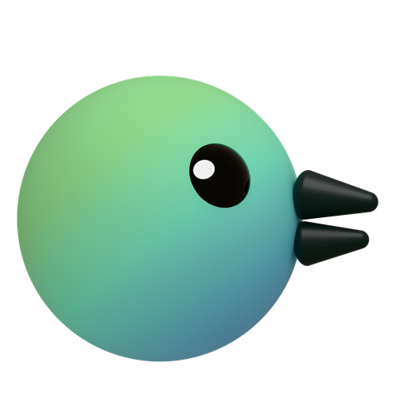
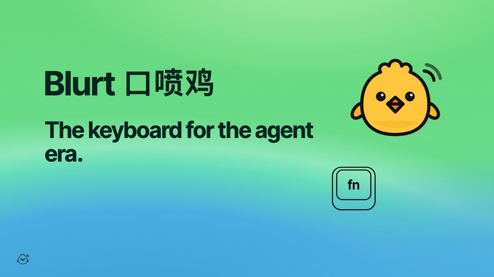

<p align="center"><picture><source media="(prefers-color-scheme: dark)" srcset="assets/peep-readme-dark.png"></picture></p>
<h1 align="center">Blurt</h1>
<p align="center"><b>The keyboard for the agent era.</b><br>
Tell your agents what you want by voice, screenshot and screen recording. Runs locally. Free and open source.<br>
<a href="https://blurt.work/en/">Website</a> · <a href="README.zh-CN.md">中文</a> · <a href="docs/guide.md">User guide</a> · <a href="#community">WeChat group</a></p>

<p align="center"><a href="https://blurt.work/en/#film"></a></p>
<p align="center"><sub>Watch the 2-minute film, sound on · <a href="https://github.com/AGIHunt/blurt/releases/latest/download/Blurt.dmg">Download for Mac</a></sub></p>

---

Blurt works with the agents you already use: Claude Code, Codex, Cursor, Claude, ChatGPT, or any text box. It handles the step
before they start: getting what you say, see and record into the input box. It isn't an agent and doesn't replace yours.

The Mac app does the most. It also runs on Windows, Linux, iPhone, iPad and Android.

## What it does

| | Key | |
|---|---|---|
| **Dictation** | `Fn` | Tap it in any app, talk, tap again: the words are typed at the cursor. Double-tap to send them too. Fillers go and punctuation comes in; your words aren't rewritten. While talking, double-tap `⇧` for a list, `⌘` to translate. |
| **Snap** | `⌥A` | Drag over part of the screen, say what's wrong, draw on it if you like. It becomes a card: drag it into an agent, a chat or a terminal, and the picture and your words go in together. |
| **Voice Note** | `⌥V` | A snap without the picture. |
| **Copy Text from Screen** | `⌥C` | Drag over text you can't select: a screenshot, a video, a page, a terminal. It's on the clipboard in about 0.2 s, with lists, tables and code indentation as they were. |
| **Translate Text from Screen** | `⌥T` | The same drag, translated, then pasted or copied. |
| **Record** | `⌥R` | Talk while you use your product. Your agent turns the recording into items, each with a screenshot, the spot marked, steps and the code involved. Review them, then hand them to your agent or send a teammate a `.zip`. |
| **Remote Control** | | Your phone becomes the computer's trackpad, keyboard and microphone, and shows its screen. One computer can drive another too. [More below](#remote-control). |

Every shortcut can be changed in Settings.

## Install

**Mac** (macOS 13 or later): [download](https://github.com/AGIHunt/blurt/releases/latest/download/Blurt.dmg) and drag it to Applications.
Signed and notarized; updates come in the app. Or run:

```bash
curl -fsSL https://blurt.work/install.sh | sh
```

On macOS 26 dictation works right away with the Mac's own speech recognition, while a local model (more accurate, works offline) downloads in the
background. On macOS 13–15, download a model or add a cloud key first. Local models need Apple silicon.

**Windows and Linux** (test builds): download from [Releases](https://github.com/AGIHunt/blurt/releases). Windows 10 (1903 or later) and 11;
Ubuntu 24.04 or later, Debian 13 or later. Dictation, voice notes, recording and Remote Control; Windows also has snaps and Copy Text from Screen.
The Windows installer isn't signed yet: when SmartScreen asks, choose More info → Run anyway.

**Phones**: the Android APK is on [Releases](https://github.com/AGIHunt/blurt/releases). The iPhone and iPad app isn't in the App Store yet:
[build it yourself](apps/ios/README.md#build-it-yourself).

## With your agents

In Settings → Agents, click Connect… and Blurt adds its skill and MCP to your agents, such as Claude Code, Codex, Cursor, Gemini CLI, Kimi Code,
OpenCode and WorkBuddy. Then start a session and say "start blurt", or ask about your items.

- Cards and dictated text go into any input box, so they work with every agent.
- Reviewed items become one instruction to paste into your agent (`⌘↩`). The agent reports progress over MCP; an item is done when you say so.
- Blurt only writes files. It has no Slack, Linear or GitHub connectors: delivery is your agent's job.

Without the app, the skill works on its own: `npx skills add AGIHunt/blurt -g`.

## Remote Control

On the computer to control, open Settings → Remote Control → Add Device…, then scan the code with your phone or paste the pairing link on another
computer. When both show the same digits, click Allow on the computer.

- **Phone to computer**: iPhone, iPad, Android phones and tablets, to a Mac, Windows or Linux computer. The talk key is Blurt's dictation key, and
  the keys follow the computer you drive.
- **Computer to computer**: any of Mac, Windows and Linux, one window per computer.

**How it connects.** On the same network, directly. Apart, Blurt's public connection service sets up a direct connection. Some networks won't
allow one; then set up [your own relay](tools/remote-relay/README.md) on the computer.

**Security.** Only devices you paired and allowed on the computer can connect. The picture, keys, voice and files are end-to-end encrypted with keys
made at pairing and kept only on those two devices; a relay passes the data on without being able to read it. The controlled computer always shows
who is controlling it, and you can disconnect at any time.

## Privacy

- Dictation, Copy Text from Screen and recording transcripts are processed on your device by default. Something goes to a cloud service only when
  you add its key and turn that feature on.
- No account.
- Snaps, recordings and items stay in your folders (`~/Blurt`, or `.blurt/` in a project). Dictation history is kept for 30 days; change that, or
  don't keep the audio.
- When your agent organizes a recording, the transcript and a few screenshots go to that agent's provider, like anything else you give it.
- Send Feedback sends only the dictations you tick, to Blurt's developers' private storage, deleted within 14 days.

More: the [user guide](docs/guide.md) covers every feature; the [FAQ](docs/faq.md) has the models and their sizes, what it costs, the full privacy
notes and a comparison with similar apps; [SKILL.md](skills/blurt/SKILL.md) is for agents.

## Community

Questions, feedback and release news are in the WeChat group 口喷鸡狂喷群: reply 口喷 to the WeChat account AGI Hunt to join. Bugs and ideas are
welcome as [GitHub issues](https://github.com/AGIHunt/blurt/issues).

<p align="center"><sub>MIT · Made by <a href="https://github.com/AGIHunt">AGI Hunt</a></sub></p>
