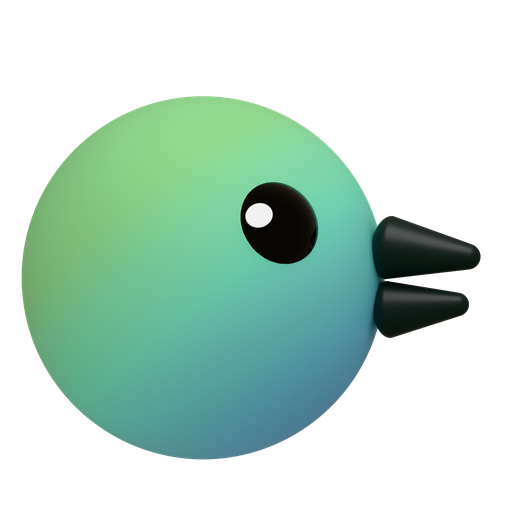
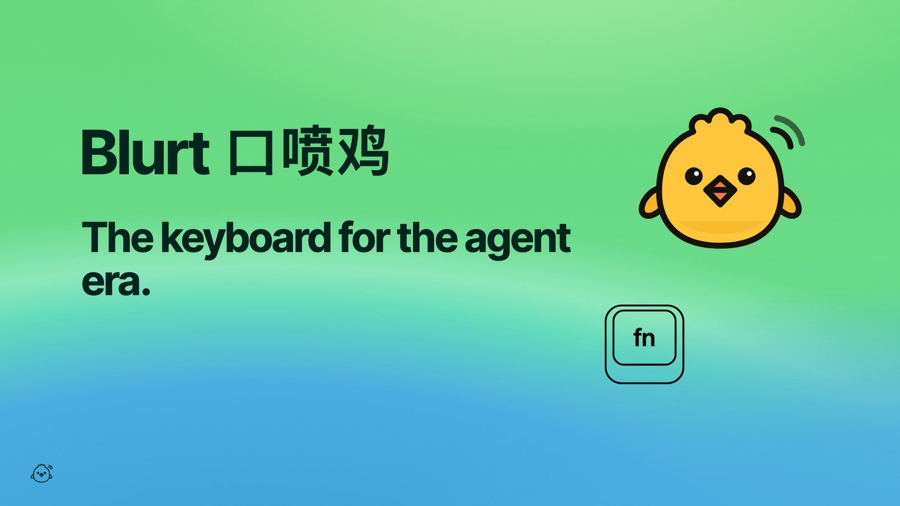

<p align="center"><picture><source media="(prefers-color-scheme: dark)" srcset="assets/peep-readme-dark.png"></picture></p>
<h1 align="center">口喷鸡 Blurt</h1>
<p align="center"><b>Agent 时代的输入法</b><br>
用说话、截图和录屏，把你想要的交给 Agent。本地运行，免费开源。<br>
<a href="https://blurt.work">官网</a> · <a href="README.md">English</a> · <a href="docs/guide.md#中文">使用指南</a> · <a href="#交流群">微信交流群</a></p>

<p align="center"><a href="https://blurt.work/#film"></a></p>
<p align="center"><sub>两分钟介绍视频，请打开声音 · <a href="https://github.com/AGIHunt/blurt/releases/latest/download/Blurt.dmg">下载 Mac 版</a></sub></p>

---

口喷鸡配合你在用的 Agent：Claude Code、Codex、Cursor、Claude、ChatGPT，或任何输入框。它只管 Agent 开始工作之前的那一步：
把你说的、看到的、录下的放进输入框。它不是 Agent，也不取代你的 Agent。

Mac 版功能最全，Windows、Linux、iPhone、iPad 和安卓也能用。

## 功能

| | 按键 | |
|---|---|---|
| **听写** | `Fn` | 在任意 App 里按一下开始说话，再按一下，文字打在光标处；连按两下会同时发送。去掉语气词、加上标点，不改写你的话。说话时双击 `⇧` 排成清单，双击 `⌘` 翻译。 |
| **截图** | `⌥A` | 框选屏幕，说一句哪里不对，也可以在图上画。截图成为一张卡片，拖进 Agent、聊天窗口或终端，图和话一起进去。 |
| **语音备注** | `⌥V` | 和截图一样，只是没有图。 |
| **截图取字** | `⌥C` | 框选任何选不中的文字，比如截图、视频、网页、终端。约 0.2 秒后进入剪贴板，列表、表格和代码缩进照原样。 |
| **截图翻译** | `⌥T` | 同样框选，翻译后粘贴或复制。 |
| **录屏** | `⌥R` | 边操作边讲。Agent 把录屏整理成事项，每条带截图、标出的位置、复现步骤和相关代码。逐条审核后交给 Agent，或打包发给同事。 |
| **远程控制** | | 手机当电脑的触控板、键盘和麦克风，也能看电脑屏幕；一台电脑也能控制另一台。见[下文](#远程控制)。 |

快捷键都可以在设置里改。

## 安装

**Mac**（macOS 13 及以上）：[下载](https://github.com/AGIHunt/blurt/releases/latest/download/Blurt.dmg)，拖进「应用程序」。已签名并经过 Apple 公证，之后在 App 里更新。
也可以在终端运行：

```bash
curl -fsSL https://blurt.work/install.sh | sh
```

macOS 26 上装好就能听写，用系统自带的语音识别，同时在后台下载本机模型（更准，不用联网）。macOS 13–15 要先下载模型，或填一个云端 Key。
本机模型需要 Apple 芯片。

**Windows 和 Linux**（测试版）：在 [Releases](https://github.com/AGIHunt/blurt/releases) 下载。支持 Windows 10（1903 及以上）和 11，
Ubuntu 24.04 及以上、Debian 13 及以上。可以听写、录语音备注、录屏和远程控制，Windows 上还有截图和截图取字。
Windows 安装包还没有签名，SmartScreen 提示时点「更多信息 → 仍要运行」。

**手机**：安卓在 [Releases](https://github.com/AGIHunt/blurt/releases) 下载 APK。iPhone 和 iPad 版还没上架，需要[自己编译](apps/ios/README.md#build-it-yourself)。

## 配合 Agent

在「设置 → Agent」里点「连接…」，口喷鸡会把它的 skill 和 MCP 装进你的 Agent，比如 Claude Code、Codex、Cursor、Gemini CLI、Kimi Code、
OpenCode、WorkBuddy。之后在 Agent 里说「开始口喷」，或者让它查你的事项。

- 卡片和听写的文字能进任何输入框，所以适用于所有 Agent。
- 审核完的事项可以复制成一条指令（`⌘↩`）粘贴给 Agent。Agent 通过 MCP 回报进度，你确认后事项才算完成。
- 口喷鸡只写文件，不做 Slack、Linear、GitHub 这类连接器，投递交给你的 Agent。

不装 App 也能用 skill：`npx skills add AGIHunt/blurt -g`。

## 远程控制

在被控的电脑上打开「设置 → 远程控制 → 添加设备…」，用手机扫码，或在另一台电脑上粘贴配对链接。两边显示相同的数字时，在被控的电脑上点「允许」。

- **手机控制电脑**：iPhone、iPad、安卓手机和平板，控制 Mac、Windows 或 Linux。说话键就是口喷鸡的听写键，按键跟着所连的电脑走。
- **电脑控制电脑**：Mac、Windows、Linux 之间都可以，每台电脑一个窗口。

**怎么连上。** 在同一网络时直接连接。不在一起时，口喷鸡的公共连接服务帮两端建立直连。有的网络打不通直连，这时可以在电脑上设置[自建中转](tools/remote-relay/README.md)。

**安全。** 只有配对过、并在电脑上点过「允许」的设备能连接。画面、按键、语音和文件全程端到端加密，密钥在配对时生成，只存在这两台设备上；
中转只负责转发，看不到内容。被控的电脑上一直显示正在被谁控制，随时可以断开。

## 隐私

- 听写、截图取字和录屏转写默认在你的设备上处理。只有填了云端 Key 并打开对应功能，那部分内容才会发给你选的服务。
- 不用注册账号。
- 截图、录屏和事项存在你的文件夹里（`~/Blurt`，或项目里的 `.blurt/`）。听写历史保留 30 天，可以改，也可以不留录音。
- 你的 Agent 整理录屏时，文字稿和几张截图会发给这个 Agent 的服务商，和你交给它的其他内容一样。
- 「发送反馈」只发你勾选的听写，存在口喷鸡开发者的私有存储里，14 天内删除。

更多：[使用指南](docs/guide.md#中文)讲所有功能；[常见问题](docs/faq.zh-CN.md)有模型和大小、费用、完整的隐私说明和与同类产品的对比；[SKILL.md](skills/blurt/SKILL.md) 是给 Agent 读的。

## 交流群

使用问题、反馈和新版本消息都在微信群「口喷鸡狂喷群」。在微信公众号「AGI Hunt」回复「口喷」即可进群。Bug 和建议也可以提 [GitHub Issue](https://github.com/AGIHunt/blurt/issues)。

<p align="center"><sub>MIT · <a href="https://github.com/AGIHunt">AGI Hunt</a> 出品</sub></p>
